# Dokumentasi dan Analisis Sistem Informasi Akademik Pesantren (SIAP)

## 1. Analisis Sistem Secara Keseluruhan
Sistem Informasi Akademik Pesantren (SIAP) adalah platform manajemen pesantren terpadu yang mencakup pengelolaan data santri, akademik, keuangan (cashless), dan operasional koperasi. Sistem ini menggunakan arsitektur **Multi-Tenancy** berbasis sekolah/lembaga di bawah satu naungan pusat.

---

## 2. Data Flow Diagram (DFD)

## 2. Data Flow Diagram (DFD)

### DFD Level 0 (Context Diagram)
Menggambarkan batasan sistem dan interaksi data antara sistem SIAP dengan entitas eksternal secara menyeluruh.

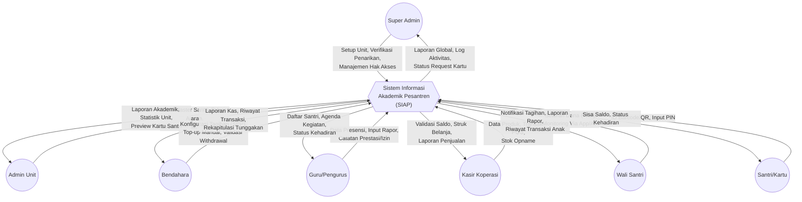

### DFD Level 1 (Diagram Proses Utama)
Memecah sistem menjadi 6 proses utama yang saling terintegrasi melalui berbagai penyimpanan data (*Data Stores*).

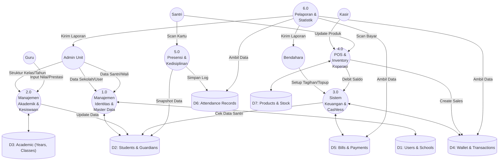

### DFD Level 2 - Detil Proses 1.0 (Identitas & Master Data)
Menjelaskan aliran data saat onboarding santri dan setup unit sekolah.

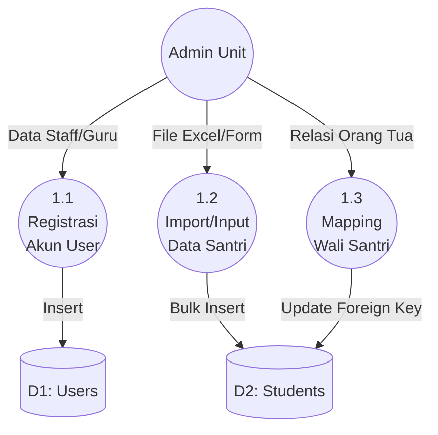

### DFD Level 2 - Detil Proses 2.0 (Manajemen Akademik)
Menjelaskan pengelolaan tahun ajaran, kelas, dan kenaikan kelas.

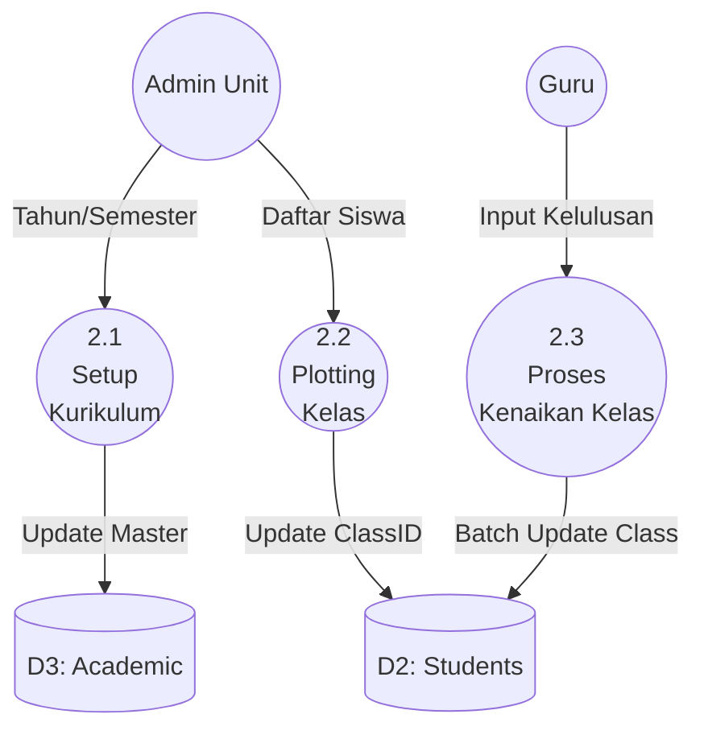

### DFD Level 2 - Detil Proses 3.0 (Keuangan & Cashless)
Menjelaskan aliran data mendalam pada sirkulasi uang elektronik santri.

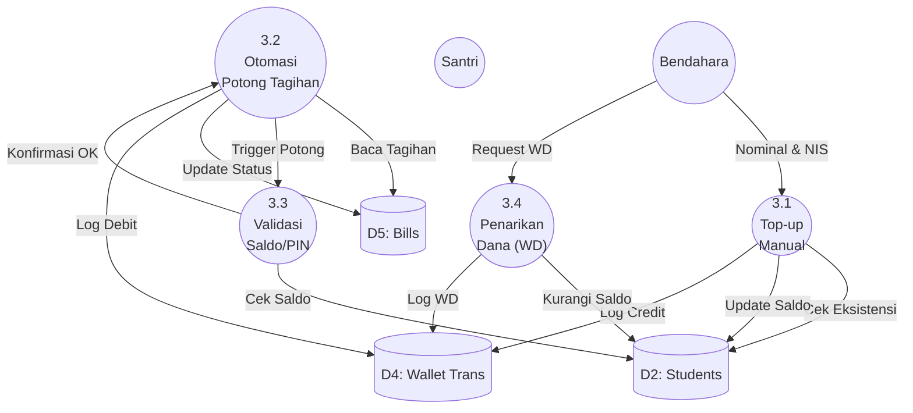

### DFD Level 2 - Detil Proses 4.0 (POS & Inventory)
Menjelaskan mekanisme transaksi ritel di Koperasi.

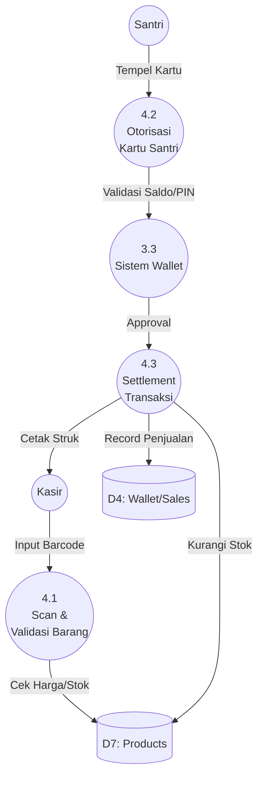

### DFD Level 2 - Detil Proses 5.0 (Presensi & Kedisiplinan)
Menjelaskan pencatatan kehadiran menggunakan scan kartu.

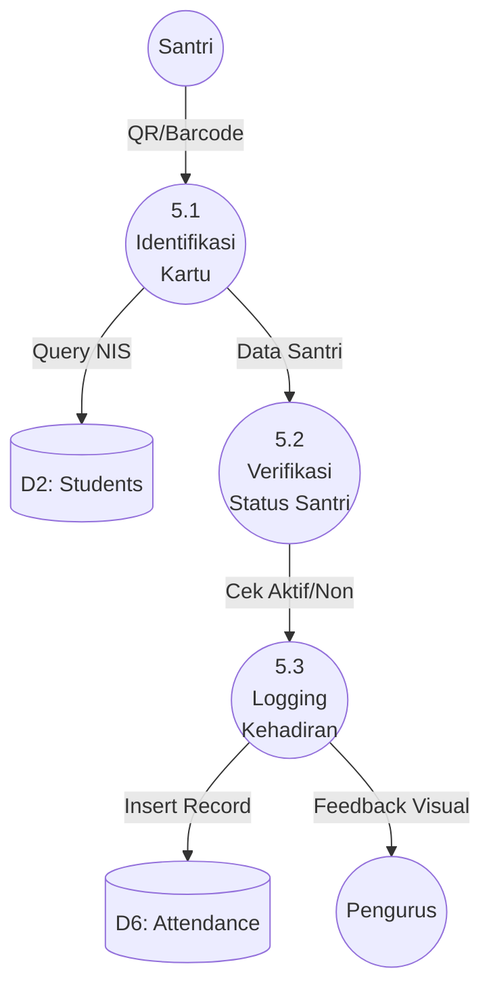


---

## 3. Sequence Diagram

### 3.1 Transaksi Pembayaran di POS Koperasi
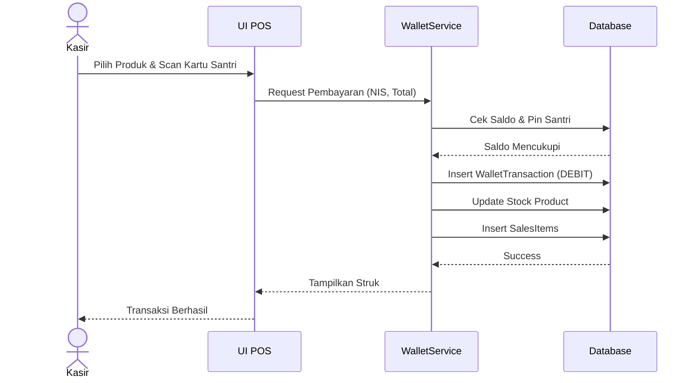

### 3.2 Presensi Santri (Scan Mode)
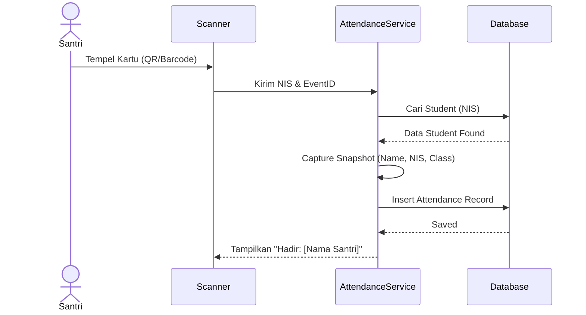

---

## 4. Activity Diagram

### Proses Pembayaran Tagihan via Saldo Dompet
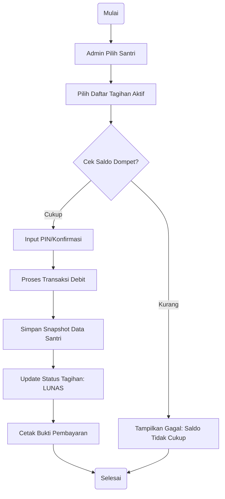

---

## 5. Flowchart Per Role

### A. Admin / Bendahara (Keuangan)
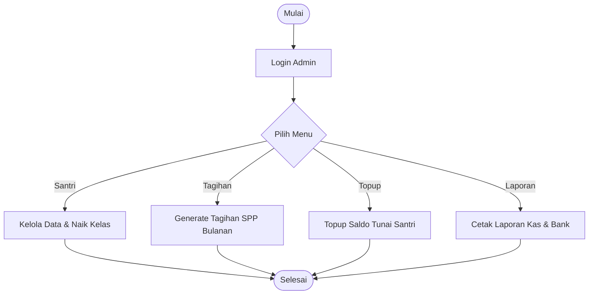

### B. Kasir Koperasi (POS)
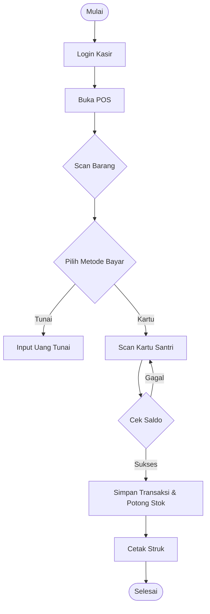

---

## 6. DBML (Database Markup Language)

```dbml
// --- SISTEM PESANTREN DBML ---

Table schools {
  id ulid [pk]
  name varchar
  address text
  logo varchar
  created_at timestamp
}

Table students {
  id ulid [pk]
  school_id ulid [ref: > schools.id]
  nis varchar [unique]
  full_name varchar
  level_id ulid [ref: > levels.id]
  parent_user_id ulid [ref: > users.id]
  wallet_balance decimal
  wallet_pin varchar
  status enum
  created_at timestamp
}

Table levels {
  id ulid [pk]
  school_id ulid [ref: > schools.id]
  name varchar // Kelas (Misal: 1A, 2B)
  department_id ulid [ref: > departments.id]
}

Table wallet_transactions {
  id ulid [pk]
  school_id ulid [ref: > schools.id]
  student_id ulid [ref: > students.id]
  type enum // CREDIT, DEBIT
  category enum // TOPUP, PURCHASE, WITHDRAWAL, BILL_PAYMENT
  amount decimal
  student_name varchar // Snapshot
  student_nis varchar // Snapshot
  student_class varchar // Snapshot
  status enum
  created_at timestamp
}

Table bills {
  id ulid [pk]
  school_id ulid [ref: > schools.id]
  student_id ulid [ref: > students.id]
  bill_category_id ulid
  amount decimal
  status enum // UNPAID, PAID, PARTIAL
  student_name varchar // Snapshot
  created_at timestamp
}

Table attendances {
  id ulid [pk]
  school_id ulid [ref: > schools.id]
  student_id ulid [ref: > students.id]
  status enum // HADIR, IZIN, SAKIT, ALFA
  student_name varchar // Snapshot
  student_nis varchar // Snapshot
  created_at timestamp
}

Table products {
  id ulid [pk]
  school_id ulid [ref: > schools.id]
  name varchar
  sku varchar
  purchase_price decimal
  selling_price decimal
  stock integer
  created_at timestamp
}
```

---

## 7. Analisis Fitur Per Role

Sistem ini memiliki pembagian fitur yang sangat spesifik untuk mendukung operasional harian berbagai departemen di pesantren:

### A. Fitur Admin (Unit Sekolah)
- **Platform**: Dashboard Statistik Unit.
- **Informasi**: Berita & Pengumuman Pesantren.
- **Akademik**: Kelola Tahun Ajaran, Semester, Jenjang Pendidikan, Data Kelas, Kegiatan Harian, dan Agenda Kegiatan.
- **Kesiswaan**: Data Prestasi, Kajian Video, Master Santri, Wali Santri, Perizinan Santri, Jadwal Sowan, dan Feedback.
- **Kartu Santri**: Manajemen pencetakan dan monitoring kartu.
- **Presensi & Laporan**: Presensi Harian, Presensi Kegiatan, Rapor Santri, dan Kenaikan Kelas.
- **Administrasi**: Kelola Pengguna (dalam unit).
- **Keuangan**: Dashboard Keuangan, Top Up Manual, Bayar Tagihan Manual, Transaksi Dompet, Tagihan (SPP), Kategori Tagihan, Tagihan Kegiatan, Penarikan Dana (Withdrawal), dan Penarikan Uang Saku.

### B. Fitur Admin Koperasi
- **Platform**: Dashboard Koperasi.
- **Operasional**: Riwayat Pembelian, Produk & Jasa, Stok Opname, Riwayat Stok, dan Kelola Kasir.

### C. Fitur Bendahara
- **Keuangan**: Dashboard Keuangan, Top Up Manual, Bayar Tagihan Manual, Transaksi Dompet, Tagihan, Kategori Tagihan, Tagihan Kegiatan, Penarikan Dana, dan Penarikan Uang Saku.

### D. Fitur Kasir Koperasi
- **POS**: Point of Sale (POS) untuk transaksi santri dan Riwayat Pembelian.

### E. Fitur Guru
- **Platform**: Dashboard Guru.
- **Informasi**: Berita & Pengumuman.
- **Presensi & Laporan**: Presensi Harian, Presensi Kegiatan, Rapor Santri, dan Kenaikan Kelas.

### F. Fitur Pengurus (Asrama/Keamanan)
- **Platform**: Dashboard Pengurus.
- **Presensi**: Presensi Harian (Subuh/Maghrib) dan Presensi Kegiatan.

### G. Fitur Super Admin (Pusat/Yayasan)
- **Platform**: Dashboard Global & Berita.
- **Administrasi**: Permintaan Cetak Kartu, Desain Kartu, Kelola Sekolah/Unit, Kelola Pengguna Global, dan Hak Akses (Roles/Permissions).
- **Keuangan**: Dashboard Keuangan Global, Metode Pembayaran, dan Kelola Penarikan Dana Sekolah.

---

## 8. Pemetaan Rute dan Hak Akses (Route Analysis)

Setiap *route* URL pada aplikasi dilindungi menggunakan Spatie Permission untuk memastikan isolasi data dan wewenang.

| Modul | Route Prefix | Role Utama |
|---|---|---|
| **Pusat (Global)** | `/super-admin/*` | `super_admin` |
| **Administrasi Unit** | `/admin/*` | `admin` |
| **Keuangan** | `/keuangan/*` (atau `/admin/keuangan`) | `admin, bendahara` |
| **Koperasi (Manajemen)** | `/koperasi/*` | `admin_koperasi` |
| **Koperasi (Kasir)** | `/koperasi/pos` | `kasir` |
| **Akademik (Guru)** | `/guru/*` | `guru` |
| **Presensi Harian** | `/presensi-kegiatan` | `guru, pengurus` |
| **Monitoring (Wali)** | `/api/*` | `wali_santri` |

---

## 9. Analisis End-to-End Workflow (Cara Kerja Sistem Secara Keseluruhan)

Sistem Informasi Akademik Pesantren ini didesain agar data mengalir saling terkait, menciptakan *loop* tertutup (closed-loop) antara administrasi, operasional asrama, dan keuangan. 

### Tahap 1: Onboarding & Setup
1. **Super Admin** membuat data **School** (Pesantren/Unit).
2. **Admin Sekolah** menginisiasi tahun ajaran, semester, dan struktur level/jenjang kelas.
3. **Admin Sekolah** mendaftarkan atau mengimpor data **Student** dan menghubungkannya dengan akun **Wali Santri**.
4. Kartu Santri (Barcode/QR) digenerate secara otomatis melalui menu *Student Cards*.

### Tahap 2: Siklus Keuangan & Operasional Koperasi
1. Wali Santri menyetorkan sejumlah uang ke pesantren (via Transfer Bank/Gateway atau Tunai ke Admin). Admin mencatat ini sebagai **Top-up Saldo** pada akun santri tersebut. Saldo bertambah.
2. Kasir Koperasi melayani santri yang ingin berbelanja kebutuhan atau jajan.
3. Kasir menggunakan **POS Koperasi** untuk memindai barang, lalu memindai Kartu Santri.
4. Sistem memverifikasi PIN dan Saldo Santri. Jika sukses, Saldo santri dikurangi, Stok barang dikurangi, dan riwayat transaksi tercatat.

### Tahap 3: Siklus Akademik & Pendampingan
1. Setiap hari, **Pengurus** atau **Guru** mendata **Absensi Kegiatan** (contoh: Jamaah Subuh, Ngaji Kitab). Santri memindai kartunya ke *scanner*, lalu data *Hadir/Alfa* tersimpan.
2. Di akhir semester, **Guru** menyusun Rapor Elektronik lalu mengunggahnya ke dalam sistem (Menu *Laporan Santri*).
3. Admin atau Guru konseling juga mencatat rekam jejak **Prestasi** dan **Perizinan** (sakit/pulang).

### Tahap 4: Pelaporan & Settlement
1. Uang yang mengendap dalam dompet digital santri sejatinya dipegang oleh Pesantren/Sekolah.
2. Jika Wali Santri meminta penarikan sisa saldo (atau santri lulus), Admin melakukan proses **Withdrawal (Penarikan Dana)**, mengembalikan uang tunai, dan saldo dompet dinolkan.
3. Bendahara menggunakan dashboard *Financial* untuk merekonsiliasi total kas masuk, keluar, serta membagi porsi biaya admin sistem sesuai persentase yang disepakati dengan pengembang aplikasi.
4. Fitur **Data Snapshot** (Denormalisasi Nama dan NIS pada tabel Transaksi/Absensi) memastikan bahwa meskipun akun santri kelak dihapus, pelaporan keuangan sekolah akan tetap valid tanpa mengalami insiden "Data Tidak Ditemukan".

---

## 10. Arsitektur Aliran Data (DFD)

### DFD Level 0 (Context Diagram)
Menggambarkan interaksi global antara sistem SIAP dengan entitas luar.

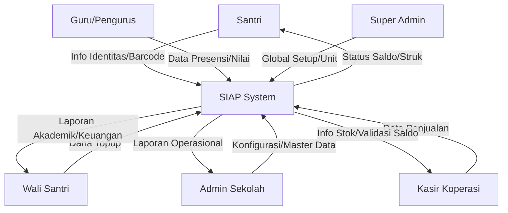

### DFD Level 1 (Proses Utama)
Pembagian sistem menjadi proses-proses inti.

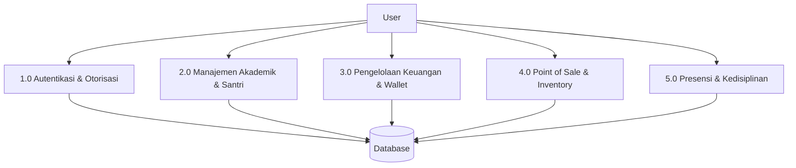

### DFD Level 2 (Modul Keuangan & POS)
Pendalaman aliran data pada transaksi non-tunai.

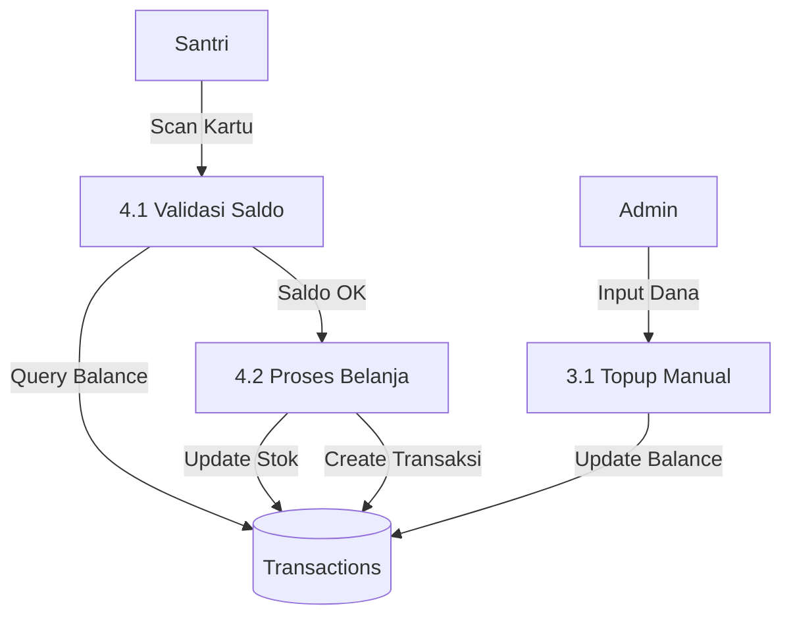

---

## 11. Diagram Urutan (Sequence Diagram) Per Modul

### Modul Keuangan: Pembayaran Tagihan (Bills)
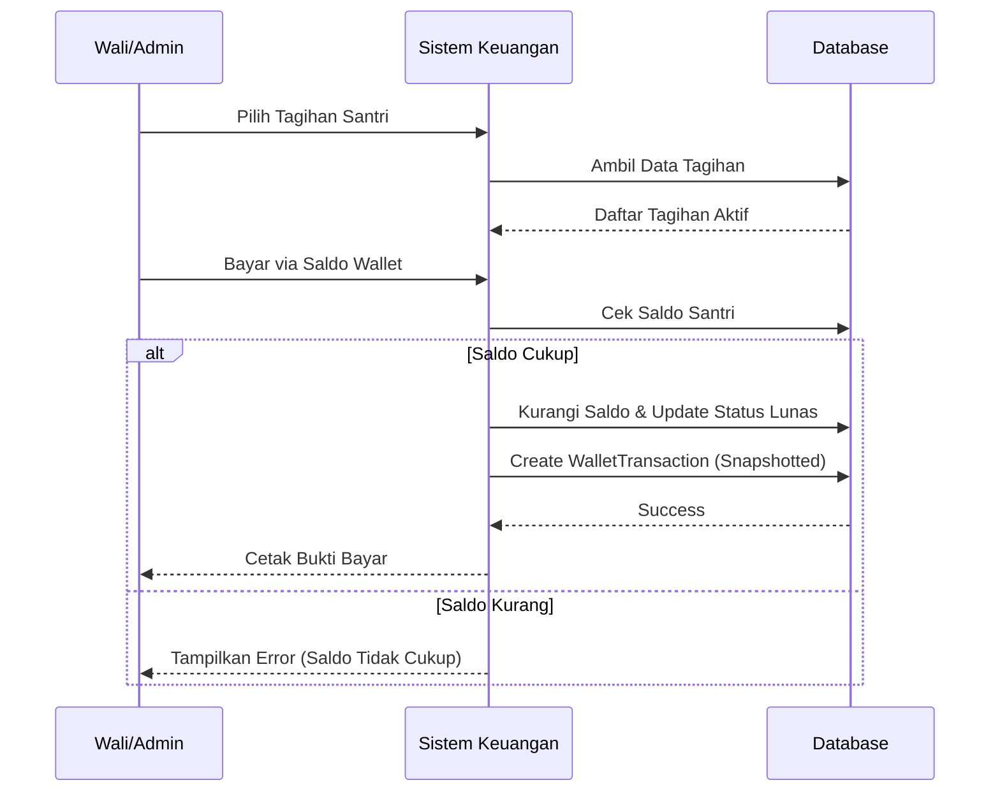

### Modul Koperasi: Point of Sale (POS)
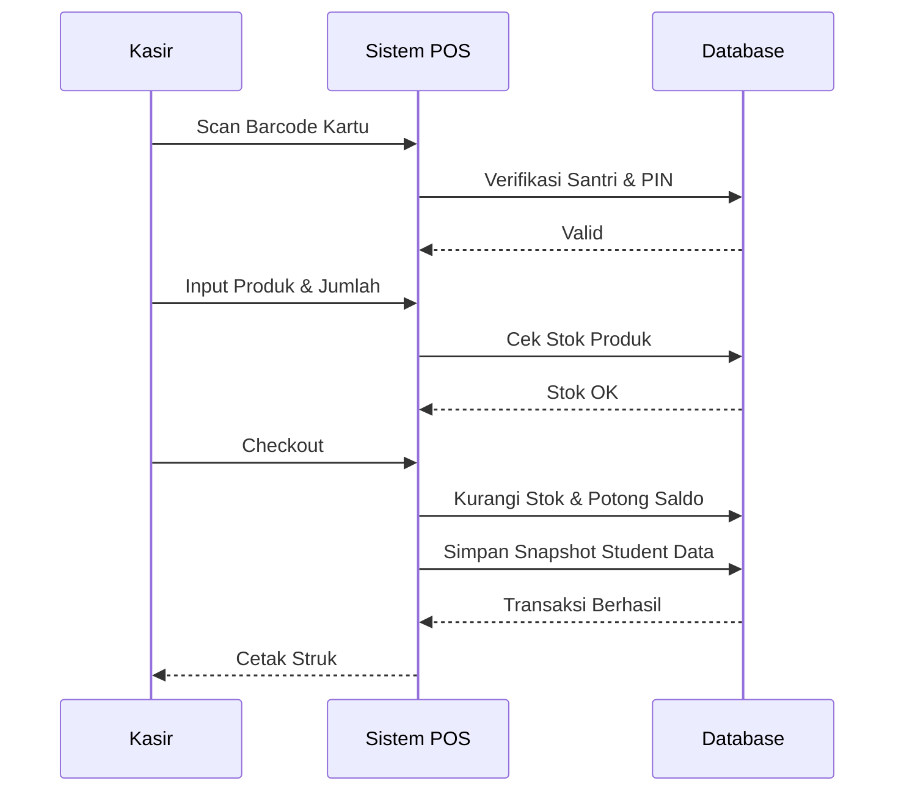

---

## 12. Diagram Aktivitas (Activity Diagram)

### Fitur: Presensi Harian (QR Scan)
```mermaid
activityDiagram
    start
    :Guru buka menu Scan Presensi;
    :Aktifkan Scanner/Kamera;
    while (Ada Santri?) is (Ya)
        :Scan Kartu Santri;
        :Sistem Cari Data Santri;
        if (Data Ketemu?) then (Ya)
            :Simpan Record Presensi;
            :Tampilkan Nama & Foto;
            :Suara "Berhasil";
        else (Tidak)
            :Tampilkan Pesan Error;
        endif
    endwhile (Selesai)
    :Rekapitulasi Kehadiran;
    stop
```

---

## 13. Diagram Alir (Flowchart)

### Overview Flowchart Sistem SIAP
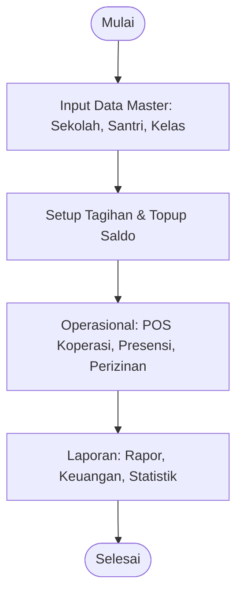

### Flowchart Per Role: Admin Koperasi & Kasir
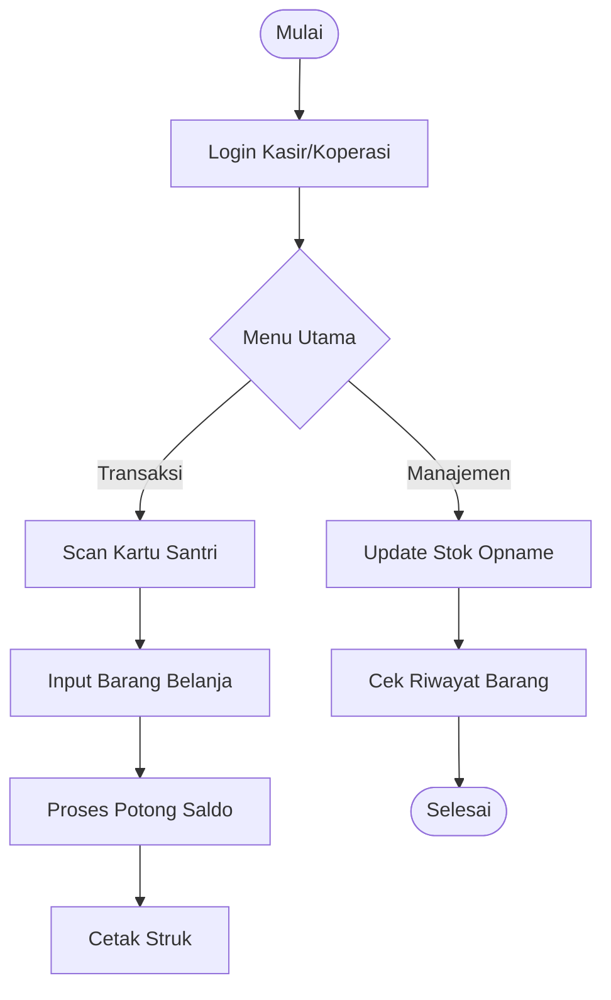

---

## 14. Skema Database Lengkap (DBML)

```dbml
// ARSITEKTUR CORE
Table schools {
  id ulid [pk]
  name varchar
  slug varchar
  address text
  created_at timestamp
}

Table users {
  id ulid [pk]
  school_id ulid [ref: > schools.id]
  name varchar
  email varchar
  password varchar
  created_at timestamp
}

// MANAJEMEN SANTRI
Table students {
  id ulid [pk]
  school_id ulid [ref: > schools.id]
  name varchar
  nis varchar [unique]
  wallet_balance decimal [default: 0]
  class_id ulid [ref: > levels.id]
}

// KEUANGAN (WALLET & BILLS)
Table bills {
  id ulid [pk]
  student_id ulid [ref: > students.id]
  student_name_snapshot varchar // Denormalisasi
  amount decimal
  status enum // UNPAID, PAID, PARTIAL
}

Table wallet_transactions {
  id ulid [pk]
  student_id ulid [ref: > students.id]
  student_name_snapshot varchar
  amount decimal
  type enum // DEBIT, CREDIT
  reference_id ulid
}

// AKADEMIK & PRESENSI
Table attendances {
  id ulid [pk]
  student_id ulid [ref: > students.id]
  status enum // HADIR, IZIN, SAKIT, ALPA
  recorded_at timestamp
}

// KOPERASI & POS
Table products {
  id ulid [pk]
  school_id ulid [ref: > schools.id]
  name varchar
  price decimal
  stock int
}

Table pos_transactions {
  id ulid [pk]
  cashier_id ulid [ref: > users.id]
  student_id ulid [ref: > students.id]
  total_amount decimal
  created_at timestamp
}
```

---

## 9. Hasil Pengujian (Pest PHP)

Sistem telah diuji menggunakan framework **Pest PHP** dengan total **72 asersi** yang mencakup seluruh fungsionalitas kritis. Seluruh skenario pengujian dinyatakan **Lulus (PASS)**.

### 9.1. Skenario Pengujian Utama
| ID | Requirement | Test Case | Status |
|---|---|---|---|
| FR-01 | Autentikasi | Login per role & Redirection Dashboard | ✅ PASS |
| FR-02 | Akademik | Kelola Tahun Ajaran, Semester, & Kelas | ✅ PASS |
| FR-03 | Kesiswaan | Import Santri & Manajemen Kartu | ✅ PASS |
| FR-04 | Keuangan | Top-up Manual & Pembayaran Tagihan | ✅ PASS |
| FR-05 | Koperasi | Transaksi POS & Stok Opname | ✅ PASS |
| FR-06 | Presensi | Scan Kartu & Laporan Kehadiran | ✅ PASS |

### 9.2. Kondisi Pengujian (Test Conditions)
| Condition ID | Test Scenario | Test Condition | Status |
|---|---|---|---|
| TCOND-01 | RBAC | Role Guru dilarang akses menu Keuangan | ✅ PASS |
| TCOND-02 | RBAC | Role Kasir dilarang akses menu Akademik | ✅ PASS |
| TCOND-03 | Wallet | Pembayaran gagal jika saldo tidak mencukupi | ✅ PASS |
| TCOND-04 | Audit | Transaksi mencatat snapshot nama santri saat itu | ✅ PASS |
| TCOND-05 | POS | Stok produk berkurang otomatis setelah transaksi | ✅ PASS |
| TCOND-06 | Akademik | Guru dapat melakukan input rapor & kenaikan kelas | ✅ PASS |

