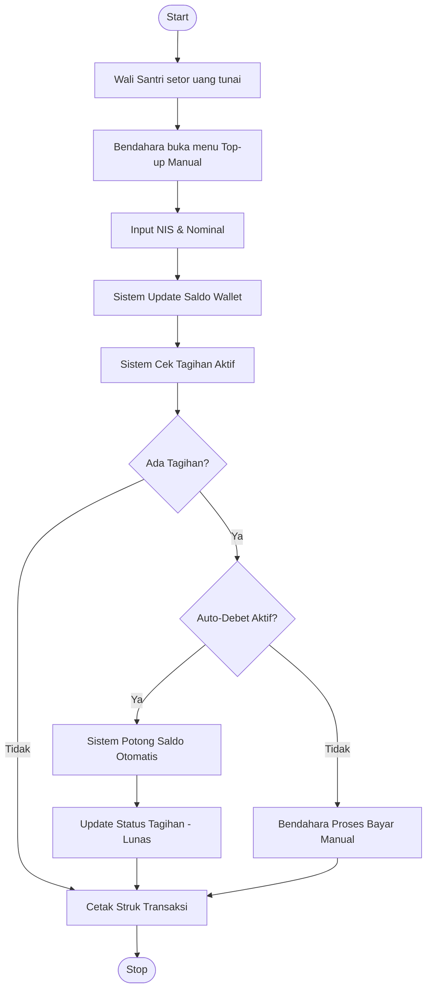
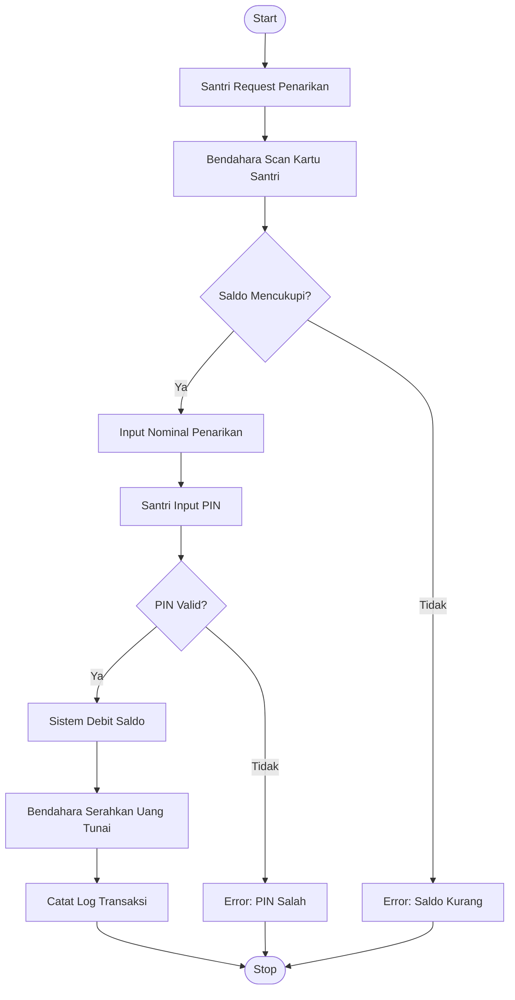
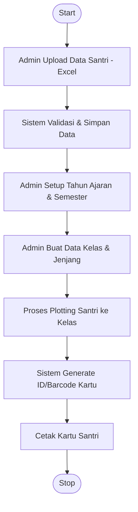
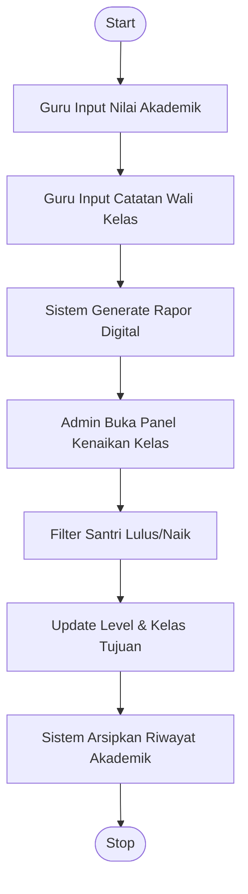
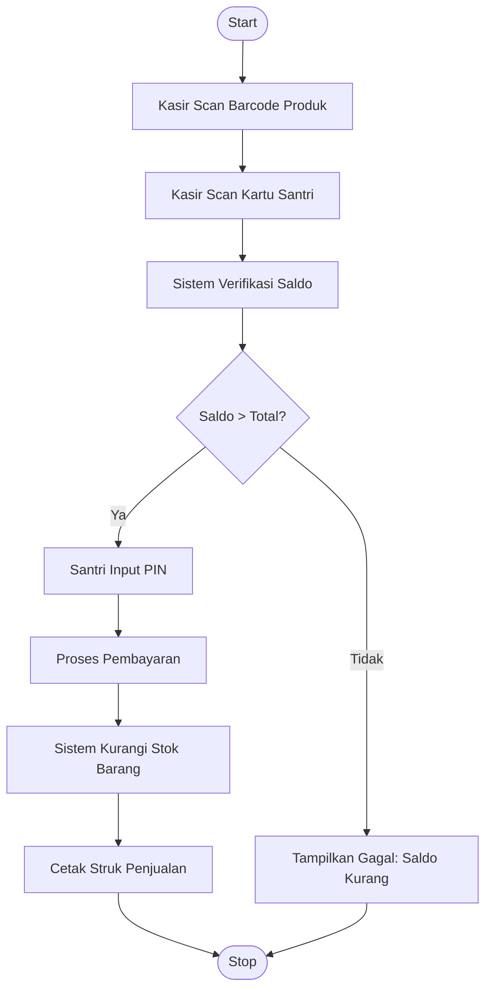
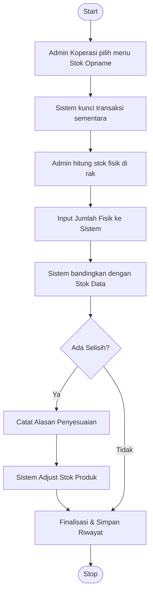
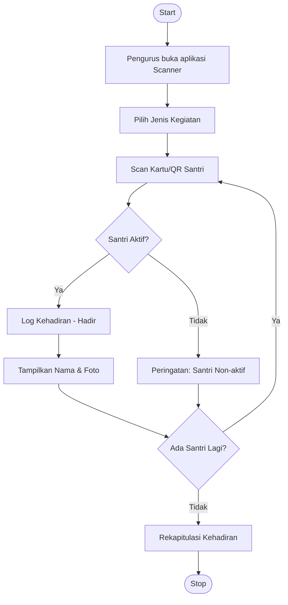
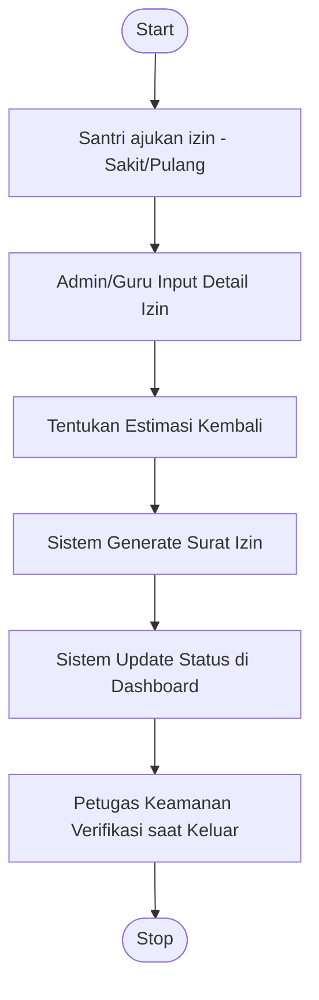
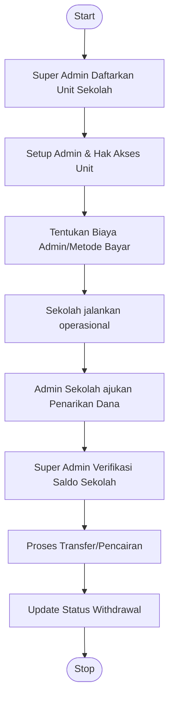

# Diagram Aktivitas (Activity Diagram) - Alur Fitur Lengkap

Berikut adalah diagram alir aktivitas untuk setiap modul utama dalam sistem manajemen Pesantren.

---

## 1. Modul Keuangan (Admin & Bendahara)

### 1.1 Alur Top-up Saldo & Pembayaran Tagihan

### 1.2 Alur Penarikan Dana & Uang Saku

---

## 2. Modul Akademik & Kesiswaan (Admin & Guru)

### 2.1 Alur Registrasi hingga Penempatan Kelas

### 2.2 Alur Kenaikan Kelas & Rapor

---

## 3. Modul Koperasi & POS (Kasir & Admin Koperasi)

### 3.1 Alur Transaksi Belanja (POS)

### 3.2 Alur Stok Opname

---

## 4. Modul Presensi & Kedisiplinan (Guru & Pengurus)

### 4.1 Alur Presensi Harian/Kegiatan

### 4.2 Alur Perizinan Santri (Permissions)

---

## 5. Modul Super Admin (Pusat)

### 5.1 Alur Manajemen Multi-Tenancy & Withdrawal

