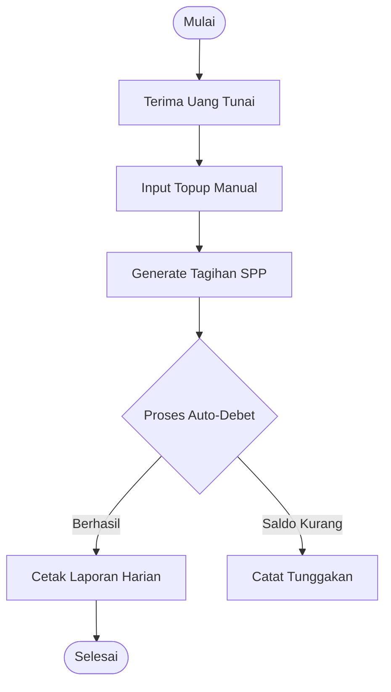
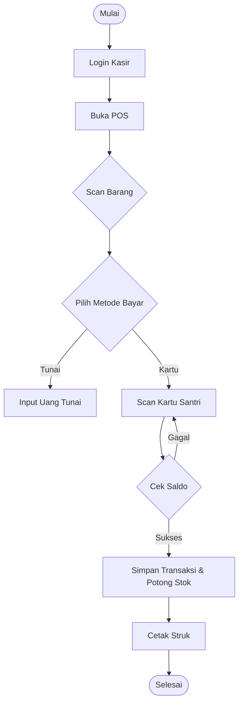

# Diagram Aktivitas & Flowchart

## 1. Activity Diagram: Kenaikan Kelas (Guru)
```mermaid
activityDiagram
    start
    :Guru buka menu Kenaikan Kelas;
    :Pilih Kelas Asal;
    :Tampilkan Daftar Santri;
    :Centang Santri yang Naik Kelas;
    :Pilih Kelas Tujuan;
    if (Konfirmasi?) then (Ya)
        :Sistem Update class_id Santri;
        :Sistem Simpan Log Histori;
        :Tampilkan Pesan Sukses;
    else (Tidak)
        :Batal;
    endif
    stop
```

---

## 2. Flowchart: Bendahara (Siklus Keuangan)


---

## 3. Flowchart: Kasir Koperasi (POS)

