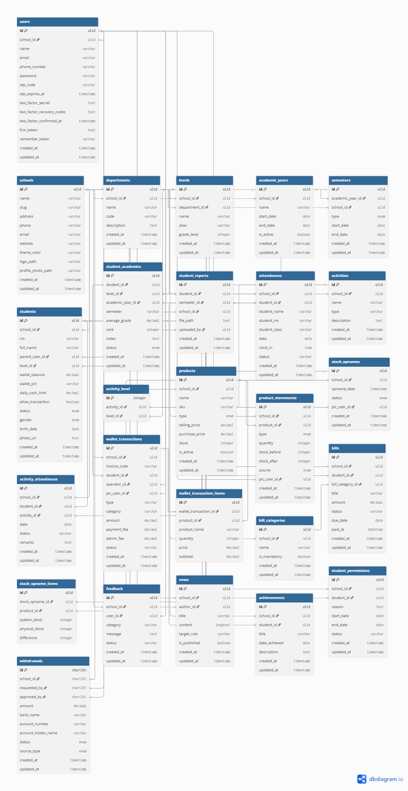

# 🗄️ Database Schema (DBML)

Dokumentasi ini merinci seluruh skema database sistem Pesantren menggunakan format **DBML**. Seluruh tabel menggunakan **ULID** sebagai Primary Key untuk skalabilitas dan integritas data multi-tenancy.



```dbml
// --- CORE TABLES ---

Table schools {
  id ulid [pk]
  name varchar
  slug varchar [unique]
  address varchar
  phone varchar
  email varchar
  website varchar
  theme_color varchar
  logo_path varchar
  profile_photo_path varchar
  created_at timestamp
  updated_at timestamp
}

Table users {
  id ulid [pk]
  school_id ulid [ref: > schools.id]
  name varchar
  email varchar [unique]
  phone_number varchar [unique]
  password varchar
  otp_code varchar
  otp_expires_at timestamp
  two_factor_secret text
  two_factor_recovery_codes text
  two_factor_confirmed_at timestamp
  fcm_token text
  remember_token varchar
  created_at timestamp
  updated_at timestamp
}

// --- ACADEMIC STRUCTURE ---

Table departments {
  id ulid [pk]
  school_id ulid [ref: > schools.id]
  name varchar
  code varchar
  description text
  created_at timestamp
  updated_at timestamp
}

Table levels {
  id ulid [pk]
  school_id ulid [ref: > schools.id]
  department_id ulid [ref: > departments.id]
  name varchar
  alias varchar
  grade_level integer
  created_at timestamp
  updated_at timestamp
}

Table academic_years {
  id ulid [pk]
  school_id ulid [ref: > schools.id]
  name varchar
  start_date date
  end_date date
  is_active boolean
  created_at timestamp
  updated_at timestamp
}

Table semesters {
  id ulid [pk]
  academic_year_id ulid [ref: > academic_years.id]
  school_id ulid [ref: > schools.id]
  type enum // GANJIL, GENAP
  start_date date
  end_date date
  created_at timestamp
  updated_at timestamp
}

// --- STUDENT & ACADEMIC DATA ---

Table students {
  id ulid [pk]
  school_id ulid [ref: > schools.id]
  nis varchar
  full_name varchar
  parent_user_id ulid [ref: > users.id]
  level_id ulid [ref: > levels.id]
  wallet_balance decimal
  wallet_pin varchar
  daily_cash_limit decimal
  allow_transaction boolean
  status enum // ACTIVE, INACTIVE, GRADUATED, DROPPED_OUT
  gender enum // L, P
  birth_date date
  photo_url text
  created_at timestamp
  updated_at timestamp
}

Table student_academics {
  id ulid [pk]
  student_id ulid [ref: > students.id]
  level_id ulid [ref: > levels.id]
  academic_year_id ulid [ref: > academic_years.id]
  semester varchar
  average_grade decimal
  rank integer
  notes text
  status enum // ONGOING, PROMOTED, RETAINED, GRADUATED, TRANSFERRED
  created_at timestamp
  updated_at timestamp
}

Table student_reports {
  id ulid [pk]
  student_id ulid [ref: > students.id]
  semester_id ulid [ref: > semesters.id]
  school_id ulid [ref: > schools.id]
  file_path text
  uploaded_by ulid [ref: > users.id]
  created_at timestamp
  updated_at timestamp
}

// --- ATTENDANCE & ACTIVITIES ---

Table attendances {
  id ulid [pk]
  school_id ulid [ref: > schools.id]
  student_id ulid [ref: > students.id]
  student_name varchar
  student_nis varchar
  student_class varchar
  date date
  clock_in time
  status varchar
  created_at timestamp
  updated_at timestamp
}

Table activities {
  id ulid [pk]
  school_id ulid [ref: > schools.id]
  name varchar
  type varchar
  description text
  created_at timestamp
  updated_at timestamp
}

Table activity_attendances {
  id ulid [pk]
  school_id ulid [ref: > schools.id]
  student_id ulid [ref: > students.id]
  activity_id ulid [ref: > activities.id]
  date date
  status varchar
  remarks text
  created_at timestamp
  updated_at timestamp
}

Table activity_level {
  id integer [pk]
  activity_id ulid [ref: > activities.id]
  level_id ulid [ref: > levels.id]
}

// --- KOPERASI & POS ---

Table products {
  id ulid [pk]
  school_id ulid [ref: > schools.id]
  name varchar
  sku varchar
  type enum // PRODUCT, SERVICE
  selling_price decimal
  purchase_price decimal
  stock integer
  is_active boolean
  created_at timestamp
  updated_at timestamp
}

Table product_movements {
  id ulid [pk]
  school_id ulid [ref: > schools.id]
  product_id ulid [ref: > products.id]
  type enum // IN, OUT, ADJUSTMENT
  quantity integer
  stock_before integer
  stock_after integer
  source enum // POS, OPNAME, MANUAL
  pic_user_id ulid [ref: > users.id]
  created_at timestamp
  updated_at timestamp
}

Table stock_opnames {
  id ulid [pk]
  school_id ulid [ref: > schools.id]
  opname_date timestamp
  status enum // DRAFT, FINAL
  pic_user_id ulid [ref: > users.id]
  created_at timestamp
  updated_at timestamp
}

Table stock_opname_items {
  id ulid [pk]
  stock_opname_id ulid [ref: > stock_opnames.id]
  product_id ulid [ref: > products.id]
  system_stock integer
  physical_stock integer
  difference integer
}

// --- FINANCIAL & WALLET ---

Table wallet_transactions {
  id ulid [pk]
  school_id ulid [ref: > schools.id]
  invoice_code varchar [unique]
  student_id ulid [ref: > students.id]
  operator_id ulid [ref: > users.id]
  pic_user_id ulid [ref: > users.id]
  type varchar
  category varchar
  amount decimal
  payment_fee decimal
  admin_fee decimal
  status varchar
  created_at timestamp
  updated_at timestamp
}

Table wallet_transaction_items {
  id ulid [pk]
  wallet_transaction_id ulid [ref: > wallet_transactions.id]
  product_id ulid [ref: > products.id]
  product_name varchar
  quantity integer
  price decimal
  subtotal decimal
}

Table bill_categories {
  id ulid [pk]
  school_id ulid [ref: > schools.id]
  name varchar
  is_mandatory boolean
  created_at timestamp
  updated_at timestamp
}

Table bills {
  id ulid [pk]
  school_id ulid [ref: > schools.id]
  student_id ulid [ref: > students.id]
  bill_category_id ulid [ref: > bill_categories.id]
  title varchar
  amount decimal
  status varchar
  due_date date
  paid_at datetime
  created_at timestamp
  updated_at timestamp
}

Table withdrawals {
  id char(26) [pk]
  school_id char(26) [ref: > schools.id]
  requested_by char(26) [ref: > users.id]
  approved_by char(26) [ref: > users.id]
  amount decimal
  bank_name varchar
  account_number varchar
  account_holder_name varchar
  status enum // REQUESTED, APPROVED, REJECTED, PAID
  source_type enum // REVENUE, TRUST_FUND
  created_at timestamp
  updated_at timestamp
}

// --- OTHERS ---

Table feedback {
  id ulid [pk]
  school_id ulid [ref: > schools.id]
  user_id ulid [ref: > users.id]
  category varchar
  message text
  status varchar
  created_at timestamp
  updated_at timestamp
}

Table news {
  id ulid [pk]
  school_id ulid [ref: > schools.id]
  author_id ulid [ref: > users.id]
  title varchar
  content longtext
  target_role varchar
  is_published boolean
  created_at timestamp
  updated_at timestamp
}

Table achievements {
  id ulid [pk]
  school_id ulid [ref: > schools.id]
  student_id ulid [ref: > students.id]
  title varchar
  date_achieved date
  description text
  created_at timestamp
  updated_at timestamp
}

Table student_permissions {
  id ulid [pk]
  school_id ulid [ref: > schools.id]
  student_id ulid [ref: > students.id]
  reason text
  start_date date
  end_date date
  status varchar
  created_at timestamp
  updated_at timestamp
}
```
