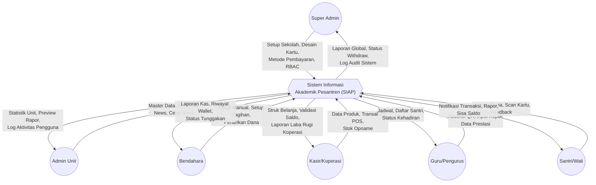
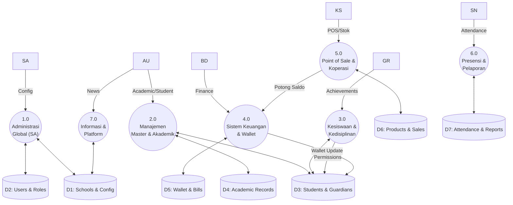
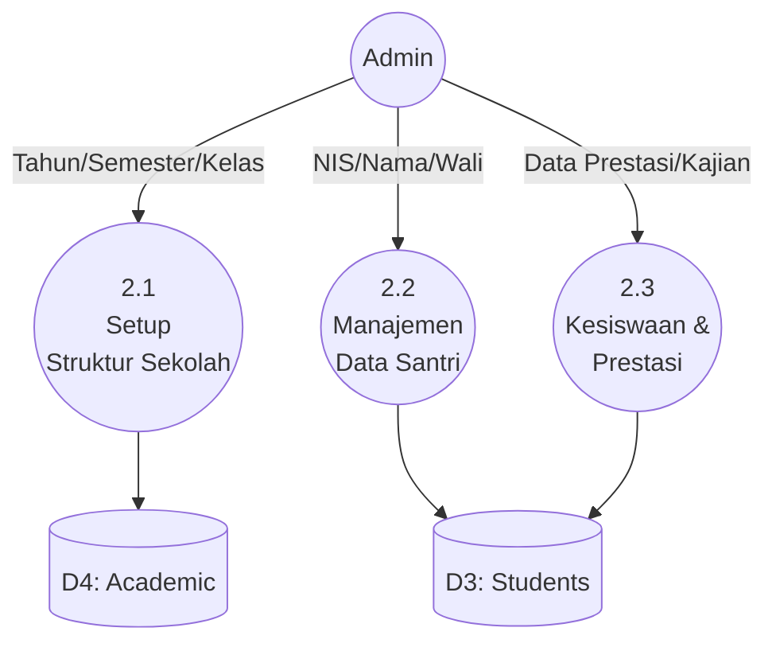
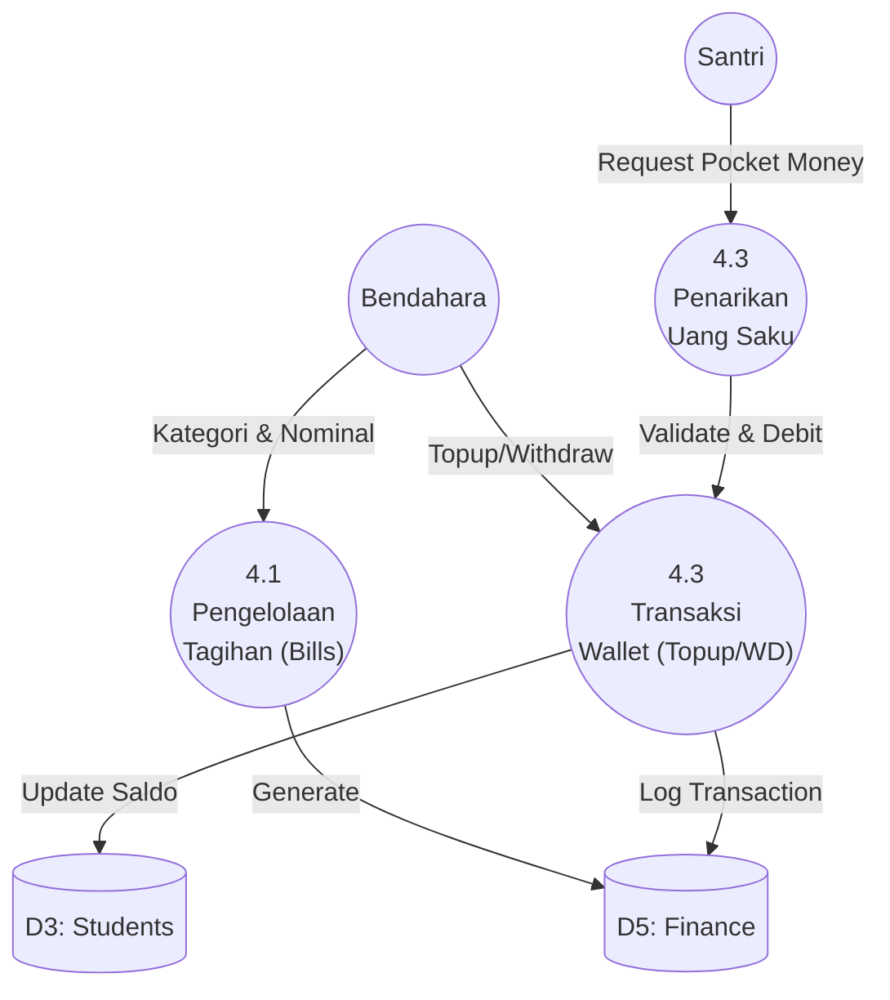
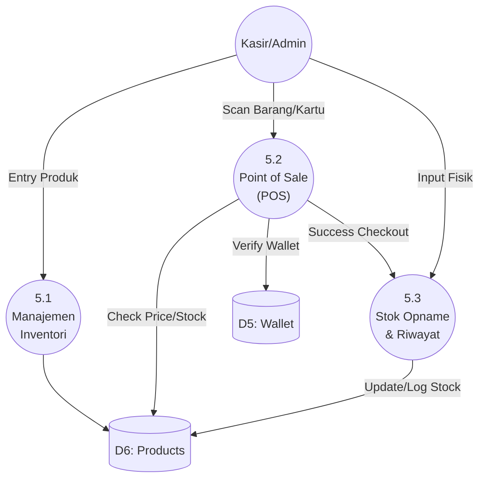
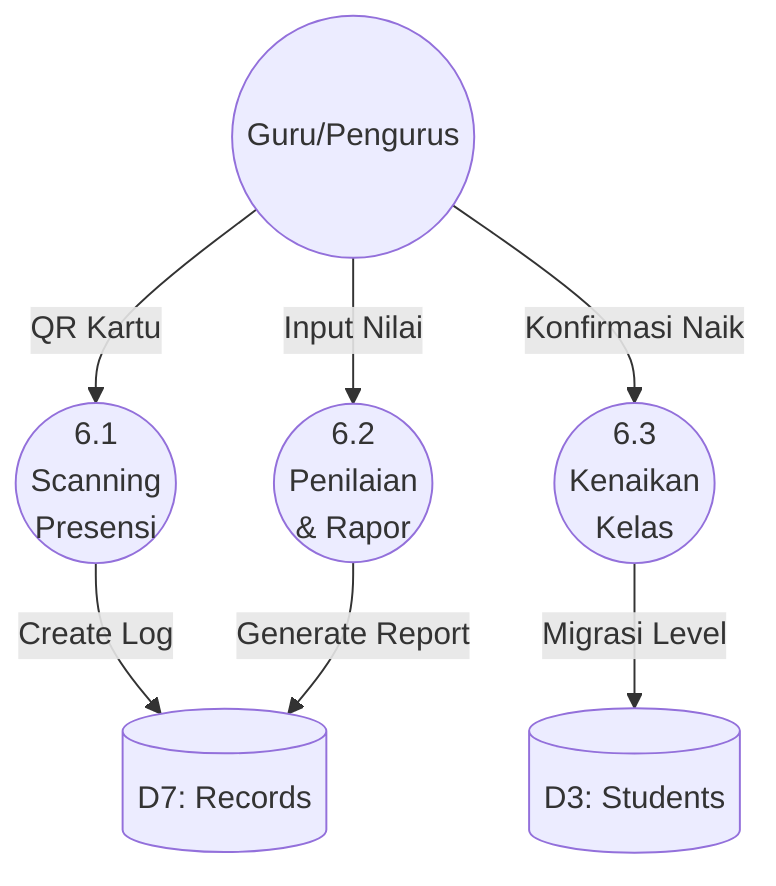
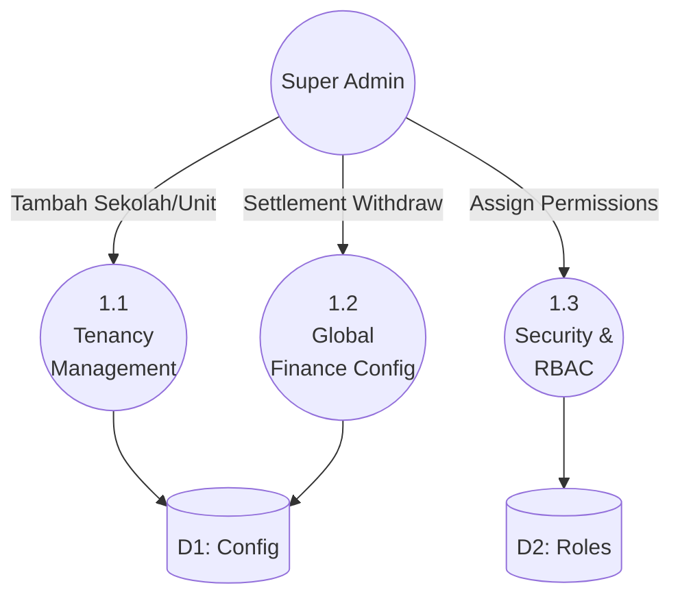

# Arsitektur Aliran Data (DFD) - Detail Fitur Lengkap

## 1. DFD Level 0 (Context Diagram)
Menggambarkan interaksi sistem SIAP dengan seluruh entitas pengguna berdasarkan fitur yang tersedia.

---

## 2. DFD Level 1 (Diagram Proses Utama)
Sistem dipecah menjadi 7 modul utama untuk mencakup seluruh fitur yang disebutkan.

---

## 3. DFD Level 2 (Detil Proses Per Modul)

### 3.1 Detil Proses 2.0 (Akademik & Kesiswaan)
Mencakup fitur: Tahun Ajaran, Semester, Kelas, Santri, Wali, Prestasi, dsb.

### 3.2 Detil Proses 4.0 (Sistem Keuangan)
Mencakup fitur: Topup, Tagihan, Dompet, Penarikan, Uang Saku.

### 3.3 Detil Proses 5.0 (Koperasi & POS)
Mencakup fitur: Produk, Stok Opname, POS, Riwayat Stok.

### 3.4 Detil Proses 6.0 (Presensi & Pelaporan)
Mencakup fitur: Presensi Harian/Kegiatan, Rapor, Kenaikan Kelas.

### 3.5 Detil Proses 1.0 (Super Admin - Global)
Mencakup fitur: Kelola Sekolah, Metode Pembayaran, Withdraw Sekolah, RBAC.

