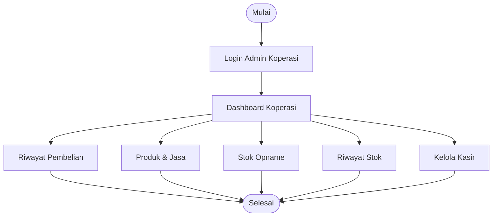
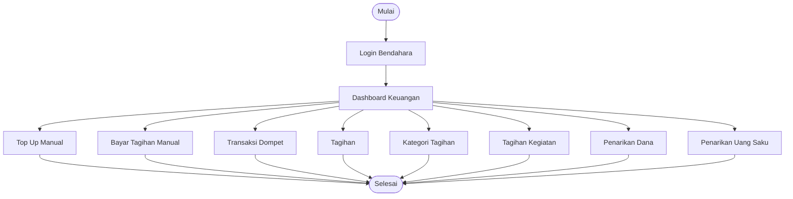
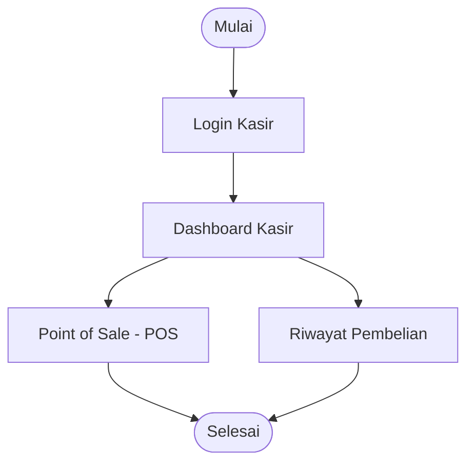
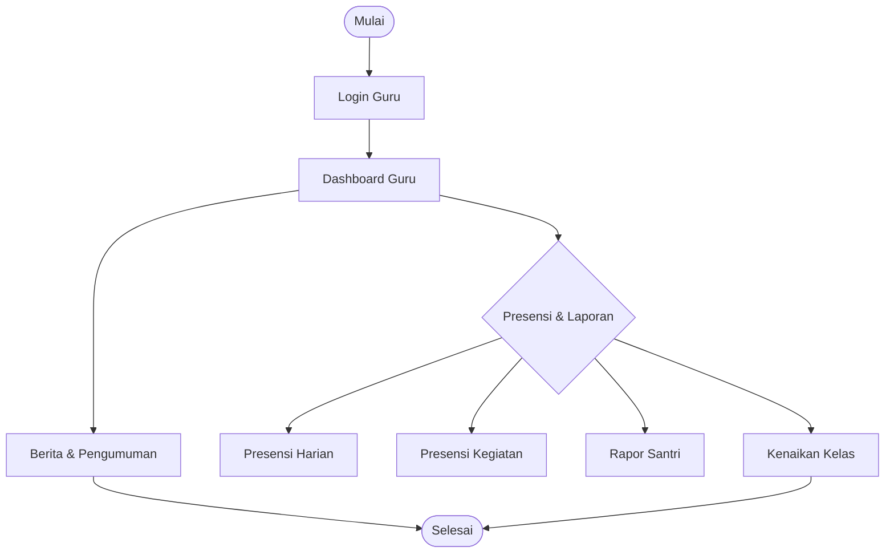
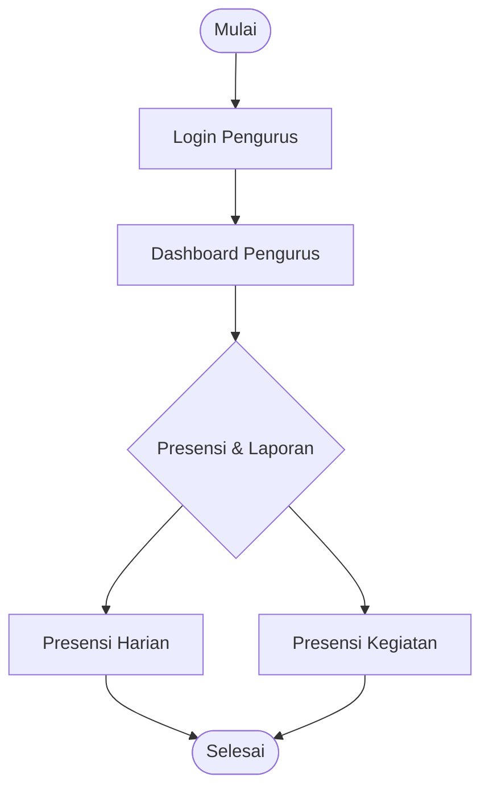
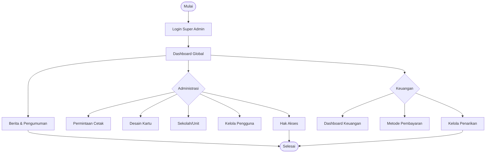

# Diagram Alir (Flowchart) Per Role - Struktur Menu Lengkap

## 1. Flowchart Admin (Lengkap)
Bagan alir navigasi dan operasional untuk role Admin Unit.

```mermaid
flowchart TD
    S([Mulai]) --> Login[Login Admin]
    Login --> Dash[Dashboard Utama]
    
    %% Cabang Platform
    Dash --> Platform{Platform}
    Platform --> News[Berita & Pengumuman]
    
    %% Cabang Akademik
    Dash --> Acad{Akademik}
    Acad --> AY[Tahun Ajaran]
    Acad --> SEM[Semester]
    Acad --> EDU[Jenjang Pendidikan]
    Acad --> CLS[Data Kelas]
    Acad --> DA[Kegiatan Harian]
    Acad --> AGE[Agenda Kegiatan]
    
    %% Cabang Kesiswaan
    Dash --> Stud{Kesiswaan}
    Stud --> PR[Prestasi]
    Stud --> KJ[Kajian]
    Stud --> SN[Santri]
    Stud --> WS[Wali Santri]
    Stud --> IZ[Perizinan Santri]
    Stud --> SW[Jadwal Sowan]
    Stud --> FB[Feedback]
    Stud --> CRD[Kartu Santri]
    
    %% Cabang Presensi
    Dash --> Pres{Presensi & Laporan}
    Pres --> PH[Presensi Harian]
    Pres --> PK[Presensi Kegiatan]
    Pres --> RP[Rapor Santri]
    Pres --> KK[Kenaikan Kelas]
    
    %% Cabang Administrasi
    Dash --> Adm{Administrasi}
    Adm --> USR[Kelola Pengguna]
    
    %% Cabang Keuangan
    Dash --> Fin{Keuangan}
    Fin --> FD[Dashboard Keuangan]
    Fin --> TM[Top Up Manual]
    Fin --> BM[Bayar Tagihan Manual]
    Fin --> TD[Transaksi Dompet]
    Fin --> TG[Tagihan]
    Fin --> KT[Kategori Tagihan]
    Fin --> TK[Tagihan Kegiatan]
    Fin --> PD[Penarikan Dana]
    Fin --> US[Penarikan Uang Saku]

    %% Terminal
    News & AGE & CRD & KK & USR & US --> End([Selesai])
```

---

## 2. Flowchart Admin Koperasi
Bagan alir navigasi untuk role Manajemen Koperasi.

---

## 3. Flowchart Bendahara
Bagan alir navigasi untuk role Bendahara Unit.

---

## 4. Flowchart Kasir
Bagan alir navigasi untuk role Kasir Koperasi.

---

## 5. Flowchart Guru
Bagan alir navigasi untuk role Guru.

---

## 6. Flowchart Pengurus
Bagan alir navigasi untuk role Pengurus.

---

## 7. Flowchart Super Admin
Bagan alir navigasi untuk role Super Admin Pusat.

