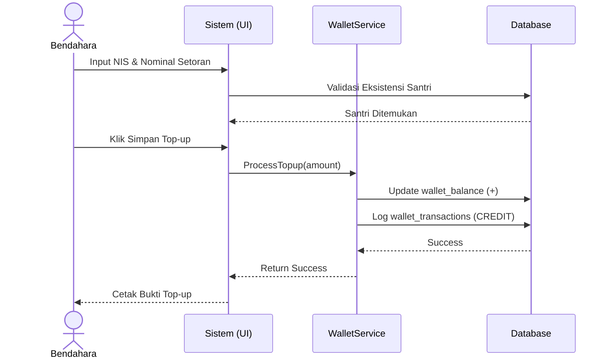
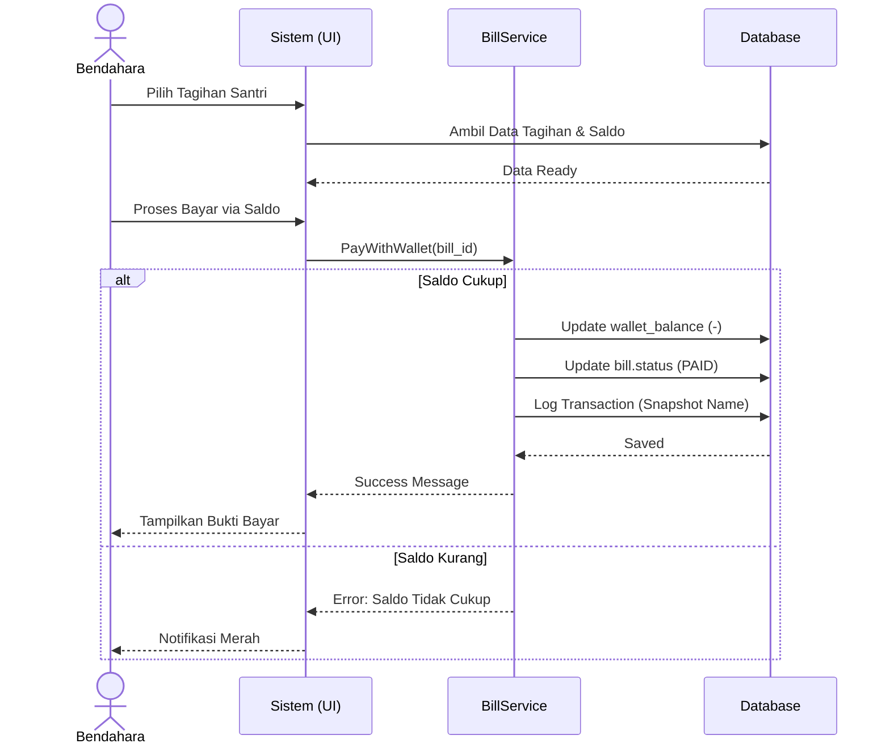
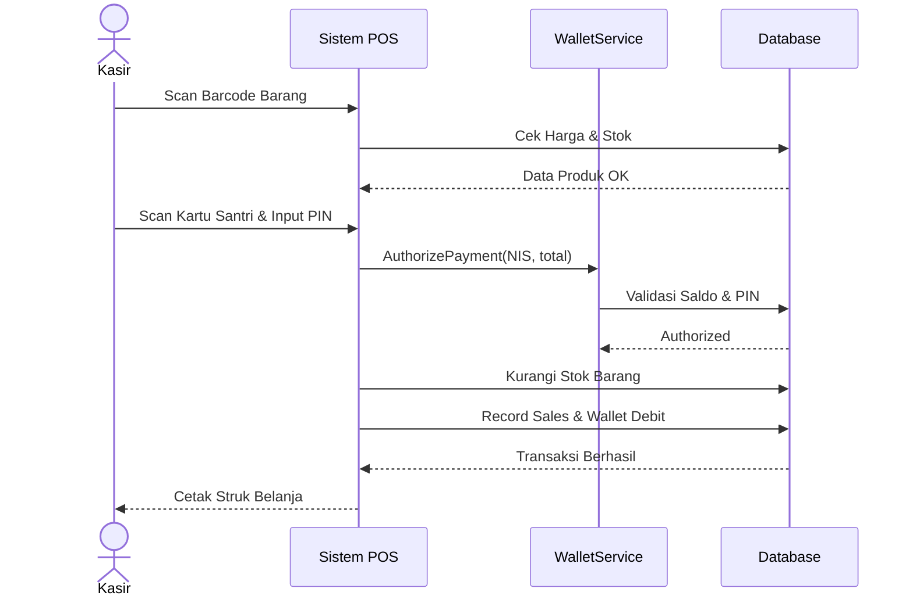
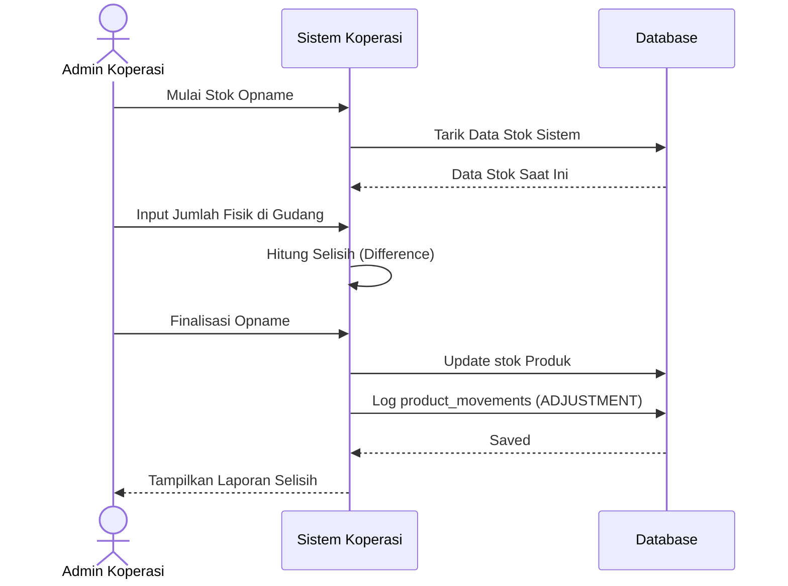
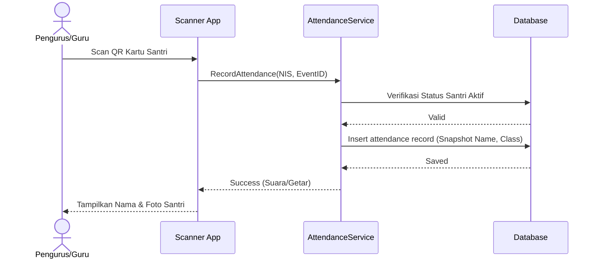
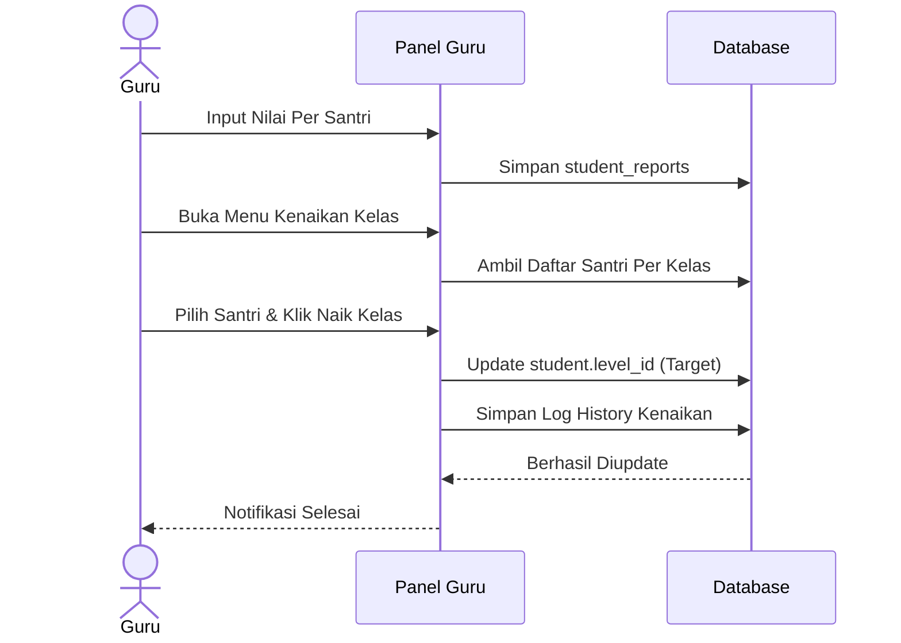
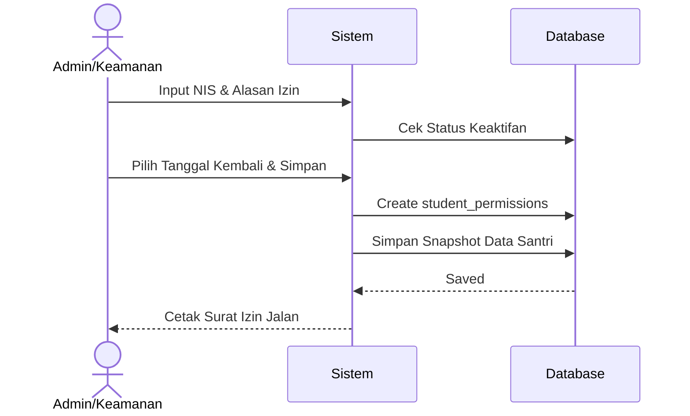
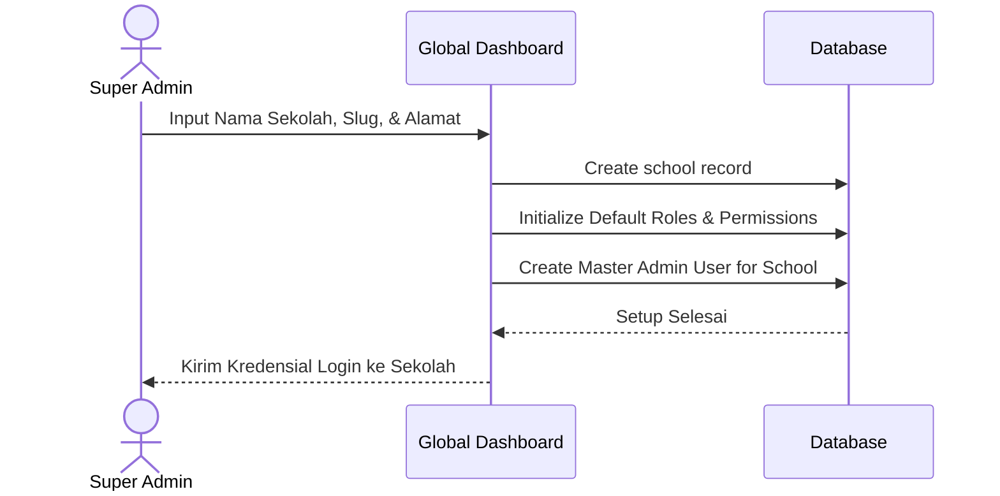

# Diagram Urutan (Sequence Diagram) - Detail Alur Fitur

## 1. Modul Keuangan (Bendahara & Admin)

### 1.1 Top-up Saldo Manual
Menjelaskan alur saat wali santri menyetor uang tunai ke Bendahara untuk mengisi saldo santri.

### 1.2 Pembayaran Tagihan Manual (Bills)
Menjelaskan alur saat Bendahara memproses pelunasan tagihan santri menggunakan saldo yang tersedia.

---

## 2. Modul Koperasi (Kasir & Admin Koperasi)

### 2.1 Transaksi POS (Point of Sale)
Alur belanja santri menggunakan kartu di Koperasi.

### 2.2 Stok Opname (Admin Koperasi)
Alur rekonsiliasi stok fisik dengan stok sistem.

---

## 3. Modul Akademik & Presensi (Guru & Pengurus)

### 3.1 Presensi QR Santri
Alur pencatatan kehadiran harian atau kegiatan menggunakan scanner.

### 3.2 Penilaian Rapor & Kenaikan Kelas
Alur akhir semester untuk penginputan nilai dan pemindahan kelas.

---

## 4. Modul Kesiswaan (Admin)

### 4.1 Pencatatan Izin Santri (Permissions)
Alur saat santri meminta izin pulang atau keluar pesantren.

---

## 5. Modul Super Admin (Global)

### 5.1 Onboarding Sekolah/Unit Baru
Alur pendaftaran lembaga/pesantren baru ke dalam sistem pusat.

