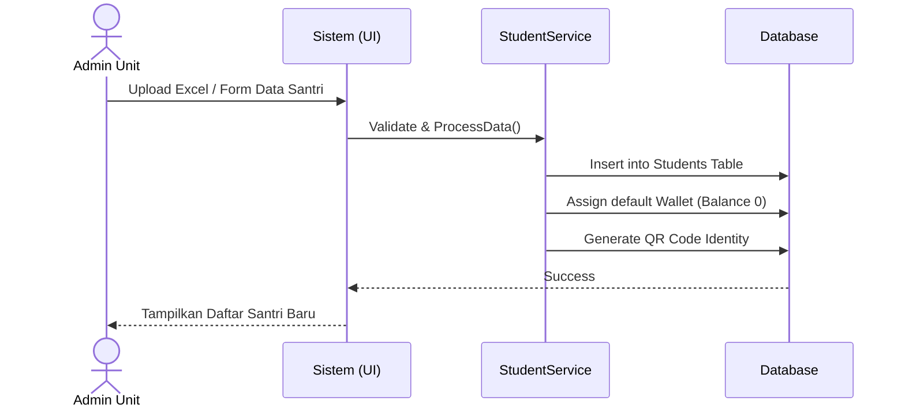
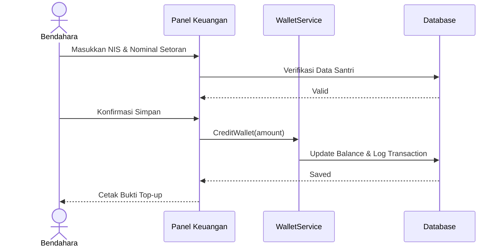
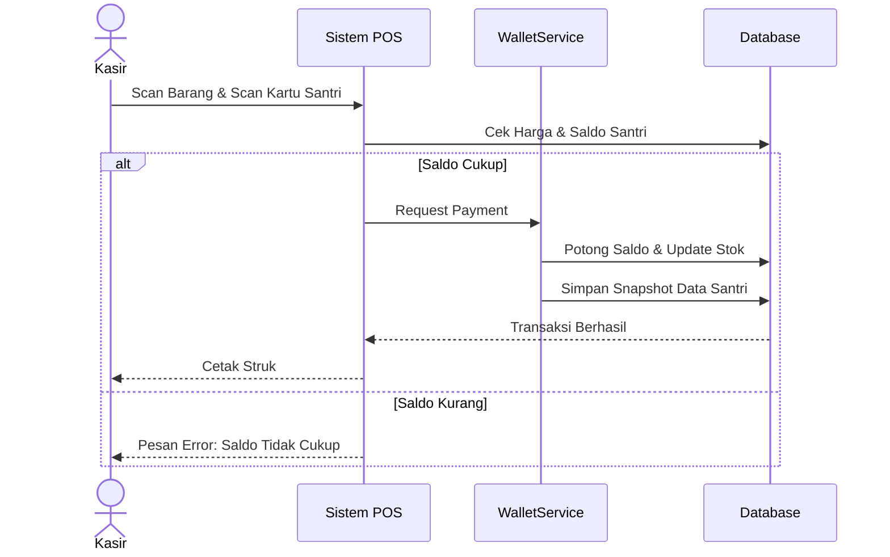
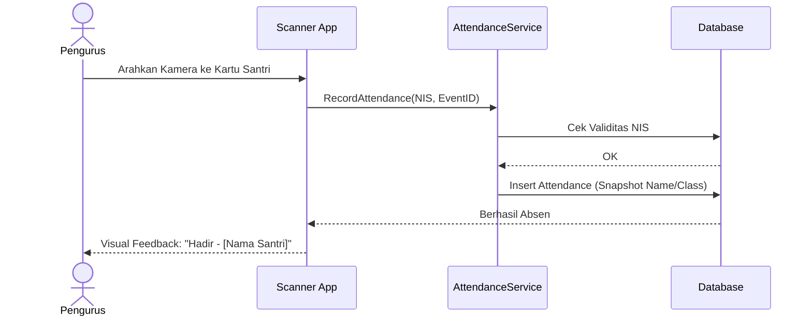

# Diagram Urutan (Sequence Diagram)

## 1. Fitur: Onboarding & Registrasi Santri (Admin)

## 2. Fitur: Top-up Saldo Manual (Bendahara)

## 3. Fitur: Transaksi POS Koperasi (Kasir)

## 4. Fitur: Presensi QR Santri (Pengurus)

